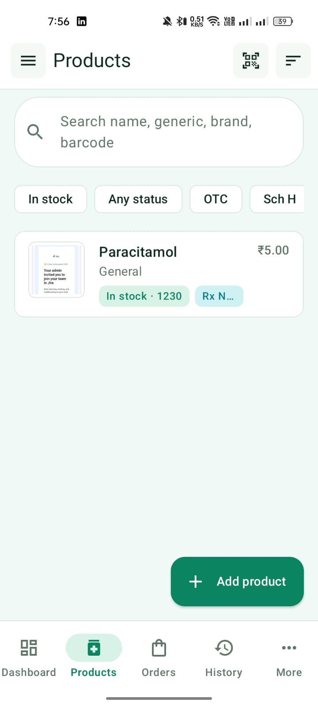
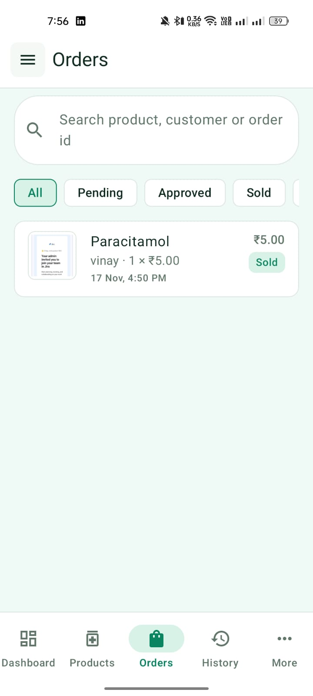
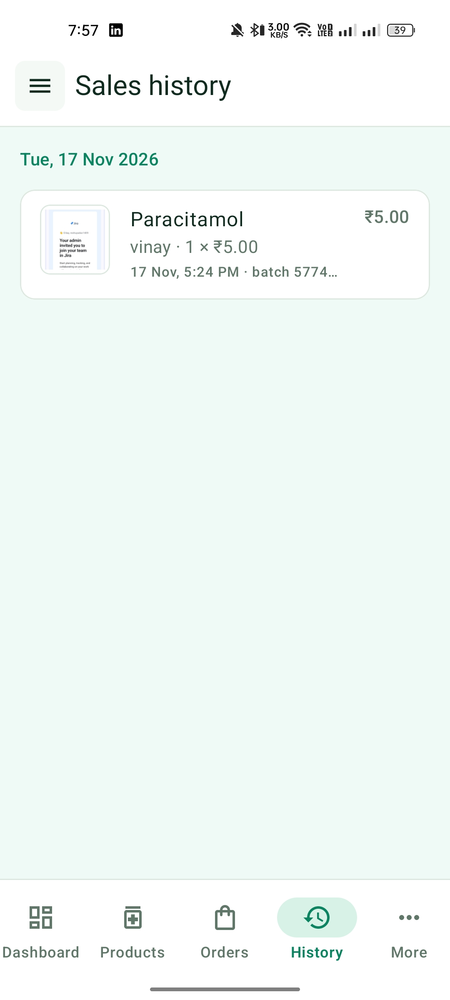
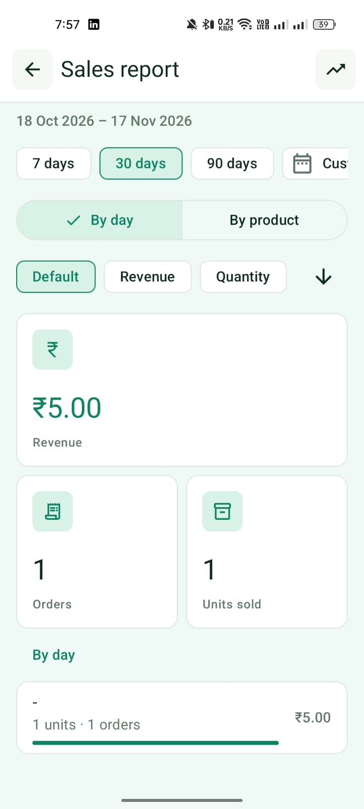

# MediAdminApp

Android admin app for a pharmacy / medical shop. The admin manages products and stock, approves customer orders, verifies prescriptions, records sales and views reports.

It works with a Flask REST API (`/api/v1`) and a separate customer app (MediUserApp) where customers browse medicines and place orders.

## Screenshots

<table>
  <tr>
    <td align="center"><br/>Products</td>
    <td align="center"><br/>Orders</td>
  </tr>
  <tr>
    <td align="center"><br/>Sales history</td>
    <td align="center"><br/>Sales report</td>
  </tr>
</table>

## Features

- **Sign in:** email and password, then a 6-digit OTP. Password reset by OTP. Sessions stay signed in and tokens refresh automatically.
- **Dashboard:** today's sales, pending and approved orders, low stock, out of stock, near-expiry and expired batches. Each tile opens the matching list.
- **Products:** add, edit, deactivate. Image, barcode, schedule type (OTC, H, H1, X, Narcotic), prescription flag, price and MRP. Barcode scanner for quick lookup.
- **Batches and stock:** batch-wise stock with expiry, stock purchase, stock adjustment and a full stock movement ledger.
- **Orders:** search and filter by status. Approve, reject, cancel, edit, mark sold, return. View the invoice for sold orders.
- **Prescriptions:** view the uploaded prescription and verify it before selling Rx medicines.
- **Sales:** sales history and reports by day or by product, with 7, 30, 90 day and custom ranges. Top selling products.
- **Inventory alerts:** low stock, out of stock, near expiry and expired tabs.
- **Suppliers:** add, edit and deactivate suppliers.
- **Customers and admins:** view and edit customers, approve or remove admins.
- **Audit log:** who changed what and when.
- **Profile, settings and about.**
- Works on phones and tablets (bottom bar on phones, side rail on large screens).

## How it works

```
Customer app            Backend (Flask)              Admin app (this project)
────────────            ───────────────              ────────────────────────
Place order      ─►     Order = PENDING       ─►     See it in Orders / Dashboard
Upload Rx        ─►     Prescription saved    ─►     Verify prescription
                                              ◄─     Approve order
                        Order = APPROVED
                                              ◄─     Mark sold
                        Stock cut batch-wise,
                        sale + invoice created ─►    Sales history, reports, invoice
```

Order status: `PENDING` → `APPROVED` → `SOLD`. An order can also be `CANCELLED` (rejected or cancelled) or `RETURNED` (after sold).

**App layers**

```
Compose screens  →  MyViewModel (StateFlow per feature)  →  Repository  →  Retrofit / OkHttp  →  Backend
```

- Every API call goes through one safe wrapper that returns Loading, Success or Error with a readable message.
- Every list and detail screen has loading, empty and error states with a Retry button.
- An OkHttp authenticator refreshes the access token on 401 and retries the request. Corrupt sessions are cleared and the user is sent back to sign in.
- Tokens are stored in encrypted storage.

## Tech stack

| Area | Library |
|---|---|
| Language / UI | Kotlin, Jetpack Compose, Material 3 |
| Navigation | Navigation Compose |
| DI | Hilt |
| Network | Retrofit, OkHttp, Gson |
| Images | Coil, uCrop |
| Scanner | CameraX, ML Kit barcode scanning |
| Storage | EncryptedSharedPreferences |
| Min / target SDK | 31 / 35 |

UI follows a green design system (Material 3, no ripple, consistent press and hold colours).

## Setup

**Requirements:** Android Studio, JDK 17, and the backend running.

1. Clone the project:
   ```bash
   git clone https://github.com/It-Saurabh001/Admin_Medi_App.git
   ```
2. Create `secrets.properties` in the project root with your backend URL (this file is not committed):
   ```properties
   # Android emulator
   WirelessPhysicalDevice=http://10.0.2.2:5000/
   # Physical device on the same Wi-Fi (use your computer's IP)
   # WirelessPhysicalDevice=http://192.168.1.100:5000/
   ```
   The app adds `api/v1/` to this URL.
3. Build and run:
   ```bash
   ./gradlew assembleDebug
   ```
4. Run unit tests:
   ```bash
   ./gradlew testDebugUnitTest
   ```

**First admin:** on an empty database the first registered admin is approved automatically. Other admins need approval from an existing admin.

## Project structure

```
app/src/main/java/com/saurabh/mediadminapp/
├── data/v1/         API interfaces, DTOs, errors, repository
├── network/         OkHttp, interceptors, token handling
├── ui/
│   ├── components/  shared UI parts
│   ├── screens/     all screens
│   ├── screens/nav/ routes, navigation, dashboard
│   └── theme/       colours, shapes, typography
└── MyViewModel.kt   state and actions for all screens
```

## Roadmap

**1. Google sign-in**
- "Continue with Google" in the customer app. The backend checks the Google ID token and links it to the account with the same email.
- Admin sign-in stays email, password and OTP.

**2. Online payments**
- UPI and card payment for customer orders through a payment gateway, confirmed by a server webhook.
- Payment status on the order and invoice. Automatic refund when an order is returned.
- Admin sees paid and unpaid orders and can filter by payment status.

**3. AI health assistant**
- Customers ask medicine and health questions in chat. The assistant suggests medicines that are in stock and shows price and prescription requirement.
- Prescription-only medicines are never suggested without a prescription. Emergency symptoms show an emergency message.
- The AI key stays on the backend only.
- Admin side: product medical info (uses, side effects, dosage, warnings), a list of AI chats with flagged and emergency conversations to review, and an on/off switch.
